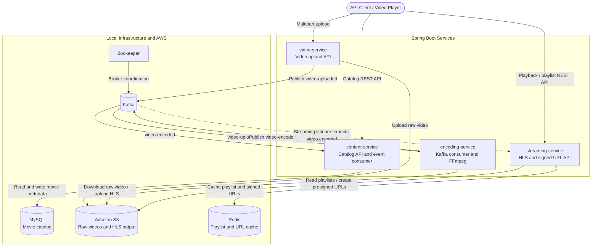

# Netflix Demo

A Spring Boot microservice-based Netflix-inspired media platform for managing movie metadata, uploads, transcoding, and streaming.

## 🏗️ System Architecture

The project is a set of Spring Boot services connected by REST APIs and Kafka events. There is no frontend in this repository; clients or a player call the service APIs.



The upload pipeline stores the original video in S3, then `encoding-service` consumes the `video-uploaded` event, uses FFmpeg to create HLS renditions, and uploads them to S3. On completion, it publishes `video-encoded`; `content-service` consumes this event to update the catalog. `streaming-service` serves playlist and signed-URL endpoints using Redis and S3.

**Known event-topic mismatch:** `encoding-service` publishes to `video-encoded`, but `streaming-service` is configured to listen on `video.encoded`. Consequently, the streaming service will not receive the encoding-complete event as currently configured, so its playlist cache is not populated by that event.

## Services

### content-service
- Exposes movie catalog APIs
- Stores metadata in MySQL
- Provides search and retrieval endpoints for content

### video-service
- Receives uploaded video files
- Stores assets in AWS S3
- Publishes `VideoUploadedEvent` to Kafka

### encoding-service
- Consumes uploaded video events
- Runs FFmpeg encoding jobs
- Publishes `VideoEncodedEvent` when processing completes

### streaming-service
- Consumes encoding completion events
- Resolves S3 media content and builds signed URLs
- Provides playlist and stream access for clients

## Interesting features

- Event-driven media pipeline: uploads trigger Kafka events, which are consumed by the encoding service and then by the streaming layer.
- FFmpeg HLS transcoding: the encoding service creates multiple bitrate renditions and a master playlist for adaptive playback.
- S3-first asset flow: raw media is stored in S3, processed in temporary work folders, and then published back as streamable HLS content.
- Content catalog integration: movie metadata is stored in MySQL, with search, filtering, and status tracking for upload and encoding state.
- Presigned streaming access: the streaming service resolves HLS playlists and generates time-limited signed URLs for secure playback.
- Shared environment configuration: all services can read a repo-level `.env` file via `spring.config.import`, while keeping `.env.example` as a checked-in template.

## How encoding works in plain English

Encoding is the process of turning one uploaded video into several versions that work well on different devices and connection speeds.

- Resolution: how large the video is in pixels. A 1920x1080 version is sharper than a 640x360 version, but it also needs more bandwidth and storage.
- Bitrate: how much data is used per second. Higher bitrate means better quality, but a larger file and more network usage.
- Frame rate: how many frames are shown each second. More frames create smoother motion, but also produce more data.
- Transcoding: creating new versions of the same video with different quality settings. In this project, FFmpeg performs that conversion.
- HLS: HTTP Live Streaming. The encoded video is split into short segments and served as playlists, so a client can switch quality while watching.
- Master playlist: the index file that lists all the available qualities for a movie, such as 1080p, 720p, 480p, and 360p.
- Adaptive bitrate streaming: the player automatically picks the best quality for the current network conditions, so playback stays smooth.

In this repository, the flow is:

1. `video-service` uploads the original file to S3.
2. A Kafka event is published with the S3 key and movie metadata.
3. `encoding-service` consumes the event and uses FFmpeg to generate multiple renditions.
4. The service creates HLS playlist files and uploads the output back to S3.
5. A second Kafka event is published with the generated HLS URL.
6. `content-service` updates the movie record with the stream URL and ready status.
7. `streaming-service` serves signed URLs for playback.

## Local infrastructure

The repository includes a Docker Compose setup for the shared dependencies:

```bash
docker compose up -d
```

This starts:

- Redis on `localhost:6379`
- MySQL on `localhost:3306`
- Zookeeper on default internal network
- Kafka on `localhost:9092`

## Prerequisites

- Java 17+
- Maven
- Docker and Docker Compose
- AWS credentials for S3 access
- FFmpeg installed and available on the system path

## Environment variables

Typical environment variables used by the services:

```bash
export AWS_ACCESS_KEY=your_access_key
export AWS_S3_SECRET_KEY=your_secret_key
export AWS_S3_REGION=us-east-1
export AWS_BUCKET_NAME=your-bucket
export AWS_S3_PRESIGNED_URL_EXPIRY=60
export FFMPEG_PATH=/usr/bin/ffmpeg
```

## Running services

From the repository root:

```bash
cd content-service
./mvnw spring-boot:run
```

```bash
cd video-service
./mvnw spring-boot:run
```

```bash
cd encoding-service
./mvnw spring-boot:run
```

```bash
cd streaming-service
./mvnw spring-boot:run
```

## Project structure

```text
Netflix/
├── content-service/
├── encoding-service/
├── streaming-service/
├── video-service/
├── docker-compose.yml
├── README.md
└── .gitignore
```

## Notes

- Some configuration files use environment-variable-backed defaults.
- Kafka and Redis are expected to be running before starting the application services.
- The project is designed for local/demo development and may require additional production hardening for real deployments.

## License

This project is intended for educational/demo use.
